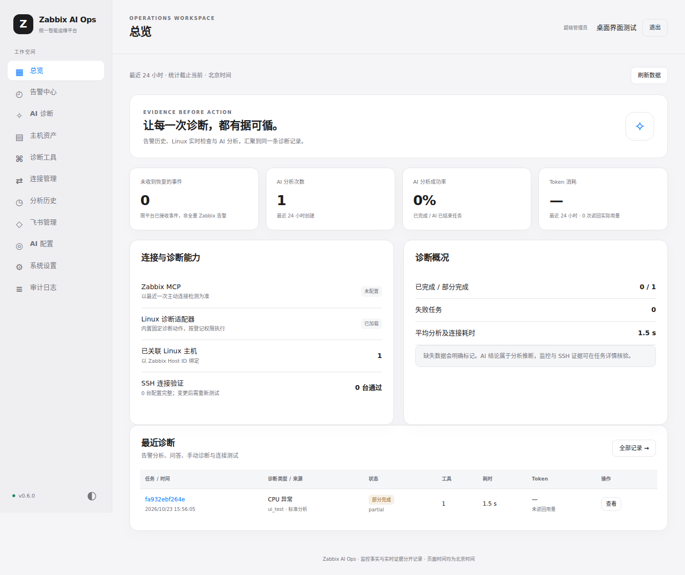

# AI Ops Platform · AI 智能运维平台

**v1.4.2** · 默认 Web 端口 **8088**。平台负责 Zabbix 告警、飞书协作、AI 分析与报告，通过三个独立的 Streamable HTTP MCP 服务获取证据（日志 MCP 可选）。

| 服务 | 职责 |
| --- | --- |
| AI Ops Platform | 登录与权限、告警、问答、分析编排、报告、审计和真实 Token 统计 |
| Zabbix MCP | 监控指标、历史趋势、事件与主机信息 |
| [SSH MCP Server](https://github.com/beijing10000-boop/ssh-mcp-server) | Linux 主机、SSH 凭据、跳板、公钥核验、实时诊断与动作授权 |
| 日志分析平台（日志 MCP） | 集中采集的操作系统、网络设备、Nginx、Java 历史日志，只读统计与检索（v1.4 起，可选） |

平台已删除内置 SSH MCP、Paramiko 执行器、公钥扫描、SSH 凭据与跳板接口、强制命令网关及相关部署。平台不保存 SSH 私钥，也不直接连接目标 SSH 端口。



## Web 管理

- 连接管理集中配置三个 MCP（Zabbix、SSH、日志）、分别验证连接，并查看诊断工具与标准流程；令牌加密保存。
- Skill 管理支持 Markdown/ZIP 上传、格式预览、编辑、启停、场景/服务范围、优先级、工具验证与导出；由 Skill 决定查询来源和步骤，任务保存完整版本快照。平台基础 Skill（platform-base）随版本自动更新，本环境规则以“补充”Skill 叠加，见 [Skill 使用说明](docs/SKILLS.md)。
- 系统配置按基础设置、飞书配置、AI 配置、服务与维护分页签展示，各自验证和保存；切换分区与更新成员保留草稿，离开前提示未保存修改。
- AI 模型、飞书、群、成员、Webhook 使用输入框或选项；分析预算使用数字输入表，取消固定最大值；任务仍按保存的预算停止。工具权限使用勾选框。
- 诊断指引和报告策略统一由 Skill 管理，按场景启用；AI 配置不再提供告警/问答独立提示词。飞书 JSON 格式、只读授权与证据安全约束仍由平台强制执行。旧提示词数据库记录保留供回退，不再用于新分析。
- 初始化、配置、Host ID 关联、诊断参数、成员与屏蔽规则具有验证入口；验证不等同于生产联调。
- 不维护本地主机资产：可选择 Zabbix 主机；启用 Skill 后也可直接在问题中指定 SSH 服务已登记的 IP，无需先查询 Zabbix。
- 告警中心支持分页、关键词、级别和恢复状态筛选，关联最近分析；暂时屏蔽集中在告警中心，显示生效与到期记录。
- 告警通知与 AI 分析分队列运行：通知不等待模型；飞书卡片上手动点击“AI分析”优先于自动分析；分析并发数由 `.env` 的 `AI_ALERT_ANALYSIS_WORKERS` 设置（默认 2）。同一事件在排队或执行期间重复点击，会提示“正在分析中”。
- 告警噪声与成本控制：同一主机、同一触发器在设定时间内（默认 2 小时）已分析过时复用该次分析；低级别或指定主机组的告警用快速模式；可设自动分析每日 Token 上限，手动分析不受限。
- 按设备类型选择诊断路径（v1.2）：平台先用 Zabbix 主机记录判定 Linux / Windows / 网络设备 / VMware。Linux 走 Zabbix 历史 + SSH 实时联合分析；Linux 未在 SSH MCP 登记或未就绪、SSH MCP 未启用或连不上时退化为只用 Zabbix；Windows 与网络设备只用 Zabbix，不因 SSH 不可用而失败。报告与飞书卡片写明实际使用的数据源和不可用原因。
- 平台维护的 Skill：platform-base（四阶段诊断流程、证据与报告规则）之外，设备类 platform-linux / windows / network 与告警类 platform-nginx / java / service / syslog 只在适用的任务中交给模型，日志证据由 platform-logs 提供。Skill 负责诊断策略，平台负责执行、权限、调度、状态与审计。
- 日志证据（v1.4）：配置日志 MCP 后，告警与 Web 诊断按主机 IP 在日志分析平台定位日志来源，预采集告警前后 30 分钟的日志概览；网络设备追加设备事件，Nginx / Java 告警追加专题统计与基线对比。未配置日志 MCP 或目标没有日志接入时，只在报告“能力说明”中注明，不算诊断不足。
- Skill 预采集：平台在第一轮模型请求前取得触发器监控项、同一对象的相关监控项、近 24 小时事件、告警前后历史与 7 天基线，并用 SSH MCP v0.6 的 `ssh_collect` 在一个会话里采集同一主机的多项实时诊断（Nginx、系统日志、Java、服务详情按告警类型选择）。SSH 工具按令牌的授权目录过滤，模型看不到无权执行的工具。
- 取证循环：同一轮的独立调用并行执行，相同调用只执行一次；结论引用的证据不足时平台要求模型先补查再总结；“已确认事实 / 高可信推断 / 待验证假设”分级，没有有效引用的“已确认事实”自动降级。报告统计输入/输出 Token、工具调用、MCP 耗时、模型推理耗时、总耗时、状态与证据覆盖。
- 证据可核验：每条工具结果带证据编号（E1、E2…），结论引用的数值由代码核对是否真的出现在对应证据中；依据可信度由核对结果决定。报告的“诊断范围”（目标、采集时间、查询窗口、证据来源）由平台生成，模型只写结论、依据和建议。
- 数据保留：Skill 快照与系统指令按内容只存一份；可设置诊断明细保留天数，到期清理证据与逐轮交互，保留结论和 Token 统计。
- 诊断详情新增“与大模型交互记录”：按轮次展示输入/输出 Token、模型耗时、已授权工具、脱敏输入与模型输出、工具调用参数和错误类别。记录加密保存在任务数据库中；只有具备 logs.read 的管理员可查看正文，普通 reports.read 只能查看元数据。记录从 v0.9.6 新任务开始产生，不补录历史任务。
- 诊断详情保留简版“下载报告”，新增管理员“下载详细报告”（Markdown）：汇总所有已保存的任务信息、告警与主机、Skill 快照、诊断结论、时间线、预算/Token、全部 MCP 工具原始证据与逐轮 AI 请求响应预览（限长/脱敏）。服务端要求 reports.read + logs.read 并记录审计，下载不受页面日志开关及 200/100 条展示限制。
- 报告显示本次分析预算、实际用量与停止原因；飞书 Token 尾注展示实际分析模式（快速/标准/深度）及任务耗时，隐藏不必要的“需人工核验：是”重复行；完整 AI 诊断报告超过单卡容量按字节分段，保留全部正文和报告链接。
- 中文诊断报告的百分比统一保留两位小数，原 KiB 数值在显示时换算为 MiB/GiB（不更改原始采集证据）。对于 SSH MCP v0.4.2 的进程摘要，可使用识别到的 Java JAR 或 systemd 单元名标识进程；无法可靠识别则如实标记，不猜测业务归属。
- Skill 支持批量获取多个 MCP 工具 Schema，减少反复 list_tools；已完整下发的工具 Schema 不会重复发送或占用采集次数。结构化历史指标发送模型时保留统计、样本和来源，超出单条结果上限时减少样本而不从中间截断，完整原始证据仍保存在加密数据库中以供核验。
- Skill 模板对实时问题直接查询 SSH，对告警与历史指标查询 Zabbix；目录最多有界展开 5 层，注明实际范围；告警诊断补查 7 天趋势基线，并结合 SSH MCP 的负载/CPU 背离、D 状态进程与 1 秒 CPU 增量判断。
- 报告支持中文进度、自动刷新、可读结论、复制和下载；分析历史可搜索任务、事件与 Trace ID。服务检查显示各队列及 Worker 注册数量。
- 保留分级告警、恢复关联、卡片 AI 分析、追问上下文、任务取消/重试、角色与审计、加密证据和桌面深浅色主题。

所有诊断都由 Skill 指引决定查询服务、工具和顺序，分析模式决定预算，不强制查询 Zabbix；平台不再保留固定的兼容诊断流程。目标与远端版本核验、授权与预算检查始终由平台执行，不切换到本地 SSH。

## 安装

已安装 Docker Engine 与 Compose 插件的 Linux 服务器：

```bash
mkdir -p /data
cd /data
git clone https://github.com/beijing10000-boop/ai-ops-platform.git
cd ai-ops-platform
docker compose up -d --build
docker compose exec -T web python -m app.bootstrap
docker compose exec -T web cat /app/data/bootstrap.token
```

在受信任内网打开 `http://服务器IP:8088/setup`，输入一次性凭据和飞书应用、管理员 Open ID、实际外部地址，验证后保存。登录后在 Web 完成 MCP（Zabbix、SSH，可选日志）、AI 和飞书配置，无需创建业务 `.env`。

独立 SSH MCP 需为 **v0.4.1 或更新版本**，推荐 **v0.7.1**：负载/CPU 背离、D 状态进程、1 秒 CPU 增量和按授权目录过滤工具依赖 v0.5.0；Nginx 日志、系统日志、Java/JVM、服务详情与端口映射、单会话多项采集（`ssh_collect`）依赖 v0.6.0。旧版本仍可运行，报告的“证据覆盖”会把缺少的工具列为跳过项并注明原因。在其 Web 登记主机、核验公钥、配置凭据，并为平台签发专用客户端令牌；实时 IP 查询无需填写 Zabbix Host ID。按 Zabbix Host ID 关联告警时仍需填写映射。

完成飞书配置并停止使用同一 App ID 的旧接收器后启动：

```bash
docker compose --profile feishu up -d feishu-receiver
```

现有整合版升级会删除旧平台 SSH 配置；请先备份数据库和配对主密钥，按 [升级说明](docs/UPGRADING.md) 操作。

| 文档 | 内容 |
| --- | --- |
| [安装部署](docs/INSTALLATION.md) | 首次部署、HTTP 内网访问、初始化与启动 |
| [升级与回滚](docs/UPGRADING.md) | 旧 SSH 配置清理、备份与恢复 |
| [Web 配置与验证](docs/CONFIGURATION.md) | 表单、验证按钮与分析预算 |
| [需求复核记录](docs/REQUIREMENTS-AUDIT.md) | 已实现功能、补充修复、验证结果与生产验收边界 |
| [架构](docs/ARCHITECTURE.md) / [SSH MCP 接入](docs/LINUX-DIAGNOSTICS.md) | 双 MCP、身份映射、预算与失败处理 |
| [Zabbix](docs/ZABBIX.md) / [飞书](docs/FEISHU.md) | 告警、恢复、群与卡片 |
| [安全](SECURITY.md) / [排障](docs/TROUBLESHOOTING.md) | 权限、密钥和常见问题 |
| [验证范围](docs/TEST-REPORT.md) / [真实验收](docs/ACCEPTANCE.md) | 自动回归与生产联调边界 |
| [v0.8 产品优化](docs/PRODUCT-REVIEW.md) | 运维流程、界面交互与可靠性改进 |

开发验证：`python -m pip install -r requirements-dev.txt`，`python -m pytest -q`，`python -m ruff check --select F401,F811,F821,F841 app tests`，`python -m ruff format --check app tests`，`node --check web/assets/app.js`。浏览器回归使用 `python tests/browser_smoke.py`；临时 Redis 由测试自行启动，未安装 Redis 的相关测试会跳过。

来源记录见 [SOURCE-REVISIONS.json](docs/SOURCE-REVISIONS.json)，依赖说明见 [THIRD-PARTY-NOTICES.md](docs/THIRD-PARTY-NOTICES.md)。
