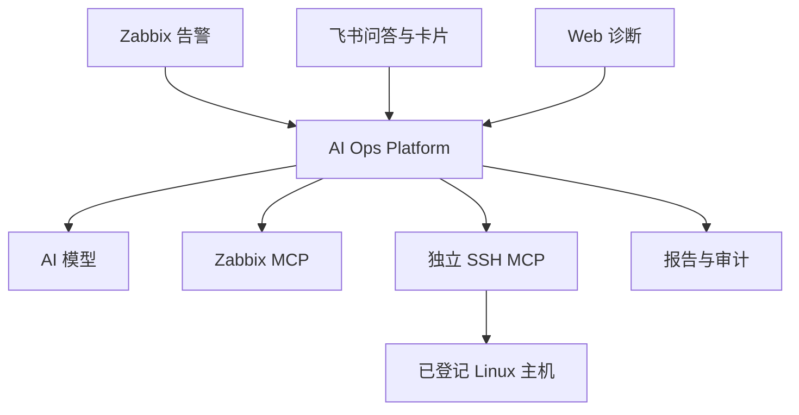

# 双 MCP 架构

AI Ops Platform 运行 Web、alert-worker、qa-worker、diagnostic-worker、Redis 与可选飞书接收器。diagnostic-worker 负责 AI 分析编排，不是 SSH 执行器。SQLite 保存加密业务配置、报告与证据；所有应用服务共享同一数据卷。

Zabbix MCP 用独立会话获取九类受限只读数据。平台不透传通用 API 方法或敏感字段。SSH MCP 第二会话按需建立，不直接向模型暴露任意远端工具；由固定剧本选择动作，平台没有 SSH 库、命令构建、主机公钥扫描、凭据管理或内置 MCP 服务。

可信告警或从 Zabbix MCP 实时核验的所选主机提供 Zabbix Host ID；仅在 Linux 类型明确时启用 SSH 补查。远端 `ssh_resolve_host` 要求唯一、已登记且授权就绪；解析结果的主机 ID 与 revision 在本任务固定，每个动作传 `expected_revision`。远端配置变化、映射错误、权限失败与超时都会停止后续补查；不重解析并转向另一资产、不按地址匹配、不回退旧本地实现。

独立 HTTP 客户端禁止跟随重定向和隐式环境代理，TLS 验证开启。HTTP 由管理员明确填写，用于受信任内网。令牌不进入模型；返回值递归脱敏、限长并单独加密记录，保留 provider、job_id、Host ID 和版本。

整体任务的轮次、采集次数、Token 和时间预算统一生效，解析主机和诊断动作逐个计数。任务取消会停止平台的后续调用；远端已经开始的同步 SSH 不保证立即停止，受 SSH MCP 自身超时限制。无远端自动重试或 exactly-once 保证。

历史监控、实时证据与模型推断分开呈现；partial、failed、cancelled 不作为故障根因已被证实。用户角色、会话与 CSRF 沿用平台权限，原始日志读取需要独立权限。
