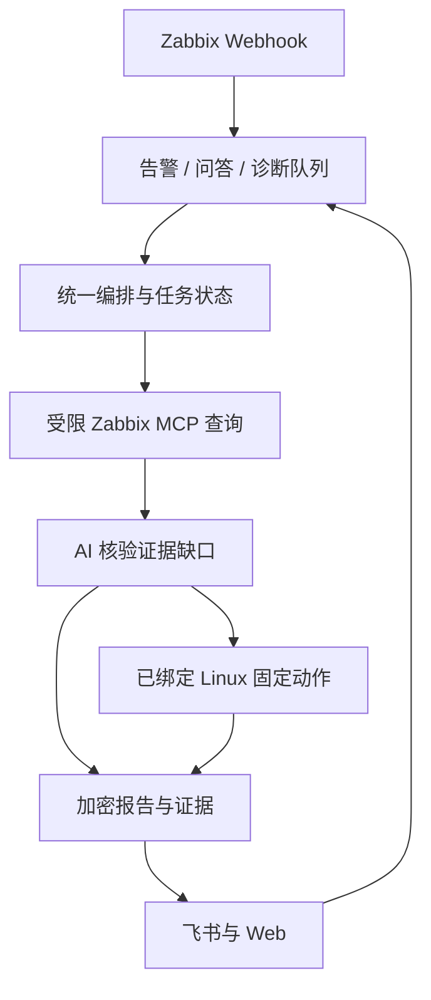

# 架构与数据流

## 进程和存储

| 服务 | 职责 |
|---|---|
| web | 8088 FastAPI、统一 SPA、OAuth、配置、Webhook、任务 API |
| alert-worker | ai-alerts 队列、原始通知、自动和卡片手动分析、恢复关联 |
| qa-worker | ai-questions 队列、飞书直接回复链、进度卡片更新 |
| diagnostic-worker | ai-diagnostics 队列、手动诊断与真实 SSH 连接测试 |
| host-key-worker | ai-host-keys 队列、批量 SSH 握手获取候选公钥；不自动信任 |
| feishu-receiver | 可选 profile，飞书长连接，入队与卡片回调 |
| redis | 队列、消息和事件去重、临时上下文与进行中标志 |
| 外部 initMAX MCP | 已部署的 Zabbix API 协议服务，不并入本平台进程 |

所有应用服务共享一个 `app.sqlite3` 和主密钥。配置、SSH 私钥与口令、任务请求、报告和证据使用 Fernet 加密；索引、资产地址、事件 JSON、任务状态和审计元数据仍是数据库明文，需保护完整数据卷。SQLite 开启 WAL、外键，增量 schema 记录在 platform_migrations。Redis 开启 AOF；noeviction 在满内存时拒绝写入，避免无声丢失队列。

## 一次诊断

1. Web 或受信任告警调用方提供结构化事件；资产只按 Host ID 精确绑定。消息正文不能指定 SSH 地址、密钥或任意命令。
2. 保存 task_id / trace_id、操作者、配置预算快照，事件级活动唯一索引阻止同一事件并发分析。
3. 告警先采集主机、事件、相关监控项和最多两个数值项的有限历史摘要，按告警时间回溯 30 分钟。快速模式预算更小。缺少可用时间时使用当前时间并依赖报告说明。
4. AI 只能发现或加载授权工具。历史 item ID 必须先验证属于本任务主机。设备类型闸门和登记资产再次确认 Linux 资格。
5. 需要实时数据时，AI 提供证据缺口原因，平台执行匹配剧本的固定动作。每个动作前复核资产版本；凭据或跳板更改使连接状态失效。时间、数量、输出均有上限。
6. 保存分来源证据、采集时间、耗时、失败与脱敏结果；AI 报告属于推断。当前 SSH 快照不能单独证明过去时刻的根因。
7. 卡片返回简短结论和登录后可见的报告链接；完整报告与日志按权限查阅。

## 工具和预算

只有 host_get、hostgroup_get、hostinterface_get、event_get、problem_get、trigger_get、item_get、history_get、trend_get 被授权。远端发现额外工具不会扩大权限。远端 Schema 只用于校验，拒绝外部引用；模型获得平台收窄后的 Schema。禁止 params、raw_json、任意 server 覆盖和密钥字段。

| 模式 | 模型交互轮 | MCP + SSH 调用 | 单轮工具 | 总时限 | Token 阈值 | 单结果字符 |
|---|---:|---:|---:|---:|---:|---:|
| quick | 2 | 4 | 3 | 65 秒 | 12000 | 2000 |
| standard | 4 | 8 | 4 | 110 秒 | 24000 | 4000 |
| deep | 6 | 16 | 8 | 150 秒 | 48000 | 6000 |

快速模式禁止 SSH。相同查询任务内缓存；种子查询也消耗调用数。轮数预算之外至多增加一次禁止工具的总结响应，仍受总时间与 Token 阈值约束。Token 根据提供商实际返回的 usage 统计；阈值在响应后检查，一次响应的输入和输出可能使总量越过阈值，不能当作计费硬上限。usage 不全时显示不可用，不用字符估算冒充实际 Token。上下文各轮有长度上限。

任务超时、证据缺失或工具部分失败保留 partial；队列异常、模型配置缺失等保存 failed；取消保留已有证据。Worker 丢失超过十分钟的 running 任务在历史读取时标记失败，支持人工重试，不自动无限重试。队列、数据库和飞书发消息不是跨系统事务，重大切换前需排空队列并核对通知状态。

## 接口边界

`/api/v1/platform/*` 包含资产/组/凭据/跳板、任务、报告、工具、成员和审计。`/api/v1/platform/host-keys` 提供批量获取、进度、失败重试及显式确认；候选公钥存在独立表，确认事务核对资产修订号后才写入可信公钥。旧 `/zabbix`、`/api/v1/ask`、OAuth 和设置接口保留。只在显式启用旧 API Token 时接受 legacy-admin，正常页面使用服务器端会话和 CSRF。

可选 `python -m app.mcp_server` 提供受信任本地 stdio MCP；只允许登记资产和固定剧本，无公开 HTTP MCP、无自由 Shell。运行它的本地用户拥有该服务的诊断权限，应像保护 worker 主机一样保护调用环境。
