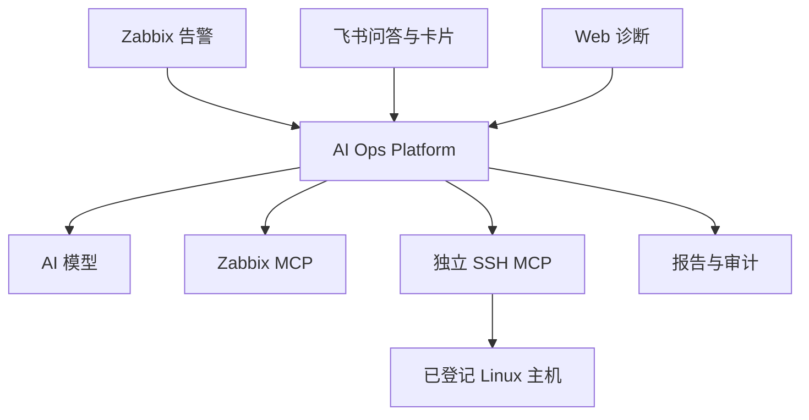

# 双 MCP 架构

AI Ops Platform 运行 Web、alert-worker、alert-analysis-worker、qa-worker、diagnostic-worker、Redis 与可选飞书接收器。alert-worker 只发送告警与恢复卡片，不等待模型；告警的 AI 分析由 alert-analysis-worker 执行（默认 2 个副本，手动“AI分析”优先于自动分析），diagnostic-worker 负责 Web 诊断。这些 Worker 只编排 AI 分析，都不是 SSH 执行器。告警分析在入队时就创建排队中的任务，同一事件排队或执行期间不会重复提交。SQLite 保存加密业务配置、报告与证据；所有应用服务共享同一数据卷。

Zabbix MCP 用独立会话获取九类受限只读数据。平台不透传通用 API 方法或敏感字段。查询哪些工具、按什么顺序由已启用的 Skill 决定（默认为平台维护的 platform-base，以及只在适用任务中加载的设备类 platform-linux / windows / network 与告警类 platform-nginx / java / service / syslog），平台不再有固定剧本；所有调用都受授权和预算约束，不向模型暴露任意远端工具。平台没有 SSH 库、命令构建、主机公钥扫描、凭据管理或内置 MCP 服务。

一次诊断分三段（v1.2）：

1. **预采集**：先读 Zabbix 主机记录判定设备类型，取触发器监控项与近 24 小时事件，并按触发器 key 校正告警分类；再按适用 Skill 的声明取相关监控项、解析 SSH 资产（仅 Linux 或未识别设备），最后并行采集 SSH 实时诊断（同一主机用 `ssh_collect` 一个会话）与告警前后历史、7 天基线，并计算确定性线索（signals）。
2. **模型取证**：模型按适用 Skill 补查；同一轮的独立调用并行执行，相同调用只执行一次；证据不足时平台要求先补查再总结。
3. **核对与报告**：平台核对结论引用的证据编号与数值，把没有有效引用的“已确认事实”降为推断，生成诊断范围（设备类型与路径、证据来源、不可用能力）、证据覆盖与预算统计。

MCP 会话在任务主协程中打开，并发调用复用同一会话；工具目录按配置在进程内缓存 60 秒，Web 上“刷新目录”通过设置项让所有进程失效。

可信告警或从 Zabbix MCP 实时核验的所选主机提供 Zabbix Host ID；仅在 Linux 类型明确时启用 SSH 补查。远端 `ssh_resolve_host` 要求唯一、已登记且授权就绪；解析结果的主机 ID 与 revision 在本任务固定，每个动作传 `expected_revision`。远端配置变化、映射错误、权限失败与超时都会停止后续补查；不重解析并转向另一资产、不按地址匹配、不回退旧本地实现。

独立 HTTP 客户端禁止跟随重定向和隐式环境代理，TLS 验证开启。HTTP 由管理员明确填写，用于受信任内网。令牌不进入模型；返回值递归脱敏、限长并单独加密记录，保留 provider、job_id、Host ID 和版本。

整体任务的轮次、采集次数、Token 和时间预算统一生效，解析主机和诊断动作逐个计数（工具参数结构查询不计）。任务取消会停止平台的后续调用；远端已经开始的同步 SSH 不保证立即停止，受 SSH MCP 自身超时限制。SSH MCP 返回 busy 或 timeout 时平台重试一次，其余失败不重试；没有 exactly-once 保证。

历史监控、实时证据与模型推断分开呈现；partial、failed、cancelled 不作为故障根因已被证实。用户角色、会话与 CSRF 沿用平台权限，原始日志读取需要独立权限。
